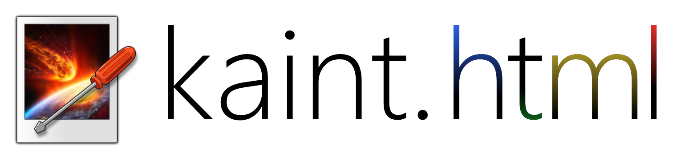

<div align="center">
  

  <h3>Kaint, ported to the web</h3>
  <p>The Paint.NET-style image editor, running entirely in your browser.</p>
</div>

---

**KaintHTML** is the web version of [Kaint](../README.md): the same look, tools, floating
windows, menus, adjustments and effects, written in plain JavaScript with no dependencies and no
build step. Everything runs locally in the browser: images never leave your computer.

## Run it

KaintHTML is a static site. Serve this folder with any web server (ES modules don't load from
`file://`) and open it in a browser:

```bash
cd KaintHTML
python3 -m http.server 8000      # then open http://localhost:8000
```

When you change the files, reload with **Ctrl+Shift+R** (or tick *Disable cache* in the browser's
developer tools): browsers keep the JavaScript modules cached and may show the old version. To try
the phone layout, use the developer tools' device mode (or make the window phone-sized).

It can also be published as-is on any static hosting (GitHub Pages, Netlify, your own server).
Chromium-based browsers get the most out of it: saving straight back to the opened file and
reading the clipboard from the menus use their File System Access and Clipboard APIs. Firefox and
Safari download the saved file and paste with Ctrl+V instead.

## Collaborative mode

Edit the same image with other people, from browsers or from Kaint (**File → Collaboration**,
settings in **Settings → Collaboration**, with a simplified and a compact view):

- **P2P (over the Internet, the default)**: **Host the current image** and share the session code;
  the others choose **Join with a code…**. The browser hosts on its own: the computers find each other
  through public WebTorrent trackers (only the WebRTC offers and answers, signed with the code, go
  through them) and the image goes straight from one to the other. Works from `https://` too.
- **Local network**: **Join a session…** lists the nearby sessions (when the page was opened from a
  session's address or with the server below running on this computer) or takes the host's address.
  Kaint serves this web version itself: open the `http://` address its session window shows. A page
  opened over `https://` can't reach a session on the local network. To **host** on the local network
  from the browser, run the small server in `tools/` (Node.js 18 or newer, no dependencies) and open
  the address it prints on the same computer:

  ```bash
  node tools/collab-server.mjs        # http://localhost:47913/ — others use http://<your-ip>:47913/
  ```

  It also announces the session so Kaint finds it, prints a key to host from another computer, and
  is a P2P signaling server at `ws://<your-ip>:47913/signal` if you'd rather not use the public ones.

Addresses and session codes stay blurred until clicked (they don't leak into screenshots or
streams), with a button to copy them. Changes are live between browsers, between copies of Kaint
and between Kaint and the web; with the host's real-time option off, guests edit a draft with its
own history and suggest it to the host, who accepts it. The protocol is described in [docs/collaboration.md](../docs/collaboration.md).

## What's in it

- **The Kaint interface**: menus, the main toolbar and the tool options bar, Kaint's drawn tool
  icons (also as cursors, with the hot spot on their tip, or small beside the system pointer for
  the selection tools, gradient, line, text and shapes), brush outlines drawn as part of the
  cursor so they follow the mouse without delay, image tabs with thumbnails and the orange star
  of unsaved images, the Tools, History, Layers and Colors windows (dockable to a corner,
  translucent, in a Windows 10 inspired style or compact, with the border width you choose;
  resizing Tools keeps whole columns and Colors scales, like in Kaint), rulers and the status bar
  with the tool icon and the zoom controls. The view scrolls past the edges of the image,
  Ctrl+wheel zooms toward the pointer and the wheel keeps a selection or stroke following the
  pointer while you drag, like in Kaint.
- **All 19 tools**: rectangle, ellipse and lasso select, magic wand, move selected pixels and move
  selection (move, resize, rotate), zoom (with the pixel-snapped rectangle), pan, paint bucket,
  gradient, paintbrush, eraser, pencil, color picker, clone stamp, recolor, text, line/curve and
  the 29 shapes. Selections combine like in Paint.NET (Ctrl, Alt, right click), and the magic wand
  follows the tolerance until you press Enter. Like in Kaint, shapes, lines, text, gradients and
  paint bucket fills stay editable: every change is a history step, and going back to one of them
  lets you keep editing it. A click with Move Selected Pixels selects the whole layer.
- **Toolbar options** like Kaint's: fill patterns, selection quality, tolerance alpha mode, fill
  accumulation, rounded rectangle radius, spiral gradients, the Overwrite blend mode and the
  sampling and gamma of Move Selected Pixels; the paint bucket, gradient and recolor tools use
  Kaint's algorithms. The Shapes menu has Kaint's sections and **custom shapes** (Paint.NET `.xaml`
  files, added in Settings > Shapes and saved in the browser).
- **Layers** with the 14 Paint.NET blend modes, opacity, visibility, drag to reorder (the layer
  follows the mouse, or a line marks where it will go) and their properties dialog; full
  **history** you can click through.
- **All of Kaint's adjustments and effects** (55, Layers > Rotate / Zoom included) with the same
  options and algorithms (ported from Kaint's C++), and dialogs like Kaint's: sliders with reset
  buttons and color strips, angle chooser, center picker over a thumbnail, rotation ball, color
  picker with transparency, tabs, linked values, Curves (luminosity or RGB) and Levels (input and
  output histograms, Auto), and Ctrl+Z / Ctrl+Y for the dialog's changes. The live preview is
  computed in the background, split among several Web Workers (like Kaint's threads), so the page
  never freezes and every change cancels the previous preview; **Ctrl+F** repeats the last one.
- **Image size dialogs** like Kaint's: by percentage or absolute size, keep aspect ratio,
  resolution (pixels/inch or pixels/cm) and print size, memory per layer; Resize with Kaint's eight
  resampling methods and gamma correction; Canvas Size with the anchor arrows. The resolution is
  saved in PNG and JPEG files.
- **Edit** > Copy Selection and Paste Selection (the Paint.NET JSON shape, with the five combine
  modes) and Grow, Shrink and Feather Selection; **View** > Pixels, Inches and Centimeters for the
  rulers and the status bar.
- **Files** like Kaint's: opens PNG, JPEG, WebP, GIF (animated GIFs as one layer per frame), BMP,
  AVIF, ICO, TGA, TIFF, DDS, QOI and Netpbm (PPM, PGM, PBM) images (HEIC and JPEG XL too, in the
  browsers that read them, like Safari), **OpenRaster (.ora)**, **Paint.NET (.pdn)** and
  **Photoshop (.psd, and .psb large documents)** with their layers; saves **Paint.NET (.pdn)**,
  OpenRaster and **Photoshop (.psd)** with their layers, PNG, JPEG, WebP, DDS, TIFF, GIF (animated,
  with Kaint's advanced options), BMP, TGA, ICO, QOI and Netpbm (PPM), plus AVIF when the browser
  can encode it. Animated GIFs open as layers or
  as separate images, and save from the layers or from the open images you pick. **Save Configuration** shows the encoded file and its size, with the
  quality, bit depth, dithering and transparency threshold. **Image > Animation** edits the frame
  durations and **Image > Color Profile** converts or assigns sRGB, Adobe RGB, Display P3 or
  ProPhoto RGB (the profile is read from and embedded in PNG, JPEG, WebP and TIFF files). Drop
  images onto the window to open them.
- **Themes**: light and dark (or follow the system), Paint.NET's Blue, Windows 7 (with 7.css's glass windows), Windows XP
  (Luna, with XP.css's), Windows 98 and Windows 98 ALT (with 98.css's) and a custom theme with Kaint's
  editable colors, and the **interface style** of Kaint or the Paint.NET 5 recreation (more
  compact, borderless windows, Windows 10 dialogs, gray and blue bar sliders and hollow handles);
  a top bar color of your own (like Windows' accent color on title bars), the interface font, and
  floating windows that snap to the edges and to each other (translucent only while they cover the
  image, like Paint.NET, or always); **English and Spanish** (Kaint's own
  translations) and Kaint's **animations**. The first visit shows a welcome window with the theme, style and language, and
  About looks like Kaint's, with its animated logo.
- **Settings** like Kaint's: interface (reopen the last session's files, recovery copies), canvas
  (custom background, checkerboard brightness, rulers), tools (the default toolbar options every
  session starts with), pen and tablet, performance (history memory limit), plugins, updates,
  diagnostics, icon packs (.zip files with an `asset-pack.json`, with a preview), fonts for the
  Text tool, custom shapes, **customization** (move any effect, plugin ones too, to another menu or
  submenu, hide effects, and choose and order the tools of the Tools window) and editable keyboard
  shortcuts.
- **Phones**: the floating windows hide in their corners behind a handle with their icon; tap it
  to slide the window out, and it hides again when you tap the canvas or pick a tool. Sliding one
  out hides the open ones it would cover (or, if you turn that off, it stays in front with its
  handle). Windows always fit on the screen, also in landscape: Tools takes more columns, Colors
  with "More" puts its sliders below the wheel when that fits better, and whatever still doesn't
  fit is scaled down. Or keep them as windows and pick the size of each one (**Settings → User
  interface → Phone**).
- **Fingers** (phones and tablets): one finger uses the tool; two fingers move the image and pinch
  to zoom, and the image keeps gliding when you let go. A stroke cut short by a second finger is
  undone. The scrollbars get thicker under a finger, and tapping one brings its thumb under your
  finger to drag it. Dialogs and windows move with one finger on their title bar, and pinching
  one with two fingers changes its size (remembered). Buttons don't stay highlighted after a tap.
- **Phone layout**: the menus (all of them) with a gear at the right whose arrow drops down the
  windows, Settings and Help; below, the main toolbar and the open images arrow, wrapping to
  another line when they don't fit. The tool options hide behind a button with the tool's icon and
  an arrow at the end of the main toolbar, which unfolds them below over as many lines as they
  need. In landscape, when there's room, the thumbnails of the open images show up at the top as
  on a computer. The open images list marks unsaved ones with the orange star on the right.
  Submenus that don't fit on the right open to the left. **Settings** shows its sections as
  icons, with the chosen one named in the title bar ("Settings - Canvas").
- **Text tool**: click or tap inside the text to put the cursor there; drag the move handle (the
  four-way cross at the bottom right, as in Kaint) or use the right button to move it. On touch
  screens, a box with an italic "A" at the top right opens or closes the on-screen keyboard.
- **Recovery copies**: every few minutes, images with unsaved changes are copied into the browser
  (IndexedDB); if the page closes abruptly, Kaint offers them the next time it opens.
- **Colors window** like Kaint's: gap-free swatches and a palette menu with saved palettes, a
  palette file to open or save, Rainbow and Small; **More** widens it with the RGB, HSV and
  opacity sliders, their number boxes and the hex code.

- **Plugins**: .paintjs packages, PhotoCraft filters (.wasm, run in a Web Worker with no access
  to anything outside) and LightCraft looks (.cube, .3dl) and develop presets (.xmp), installed
  from **Settings → Plugins** or by dropping them on the window. Each effect of a plugin can be
  turned on or off on its own.

Not available on the web: Paint.NET (.dll) and native plugins and scanning. Reopening the last session's files needs a browser with access to the system's
files (Chrome, Edge...). Browsers keep some shortcuts for themselves (Ctrl+N, Ctrl+W, Ctrl+T): use
the menus for those.

## Android

`../build-apk.sh` turns this folder into **Kaint.APK**, an Android app (the source is in
`../android`): it asks whether you want an APK or an App Bundle for Google Play and leaves it in
`build-apk/` or `build-aab/`. Inside the app, Open uses Android's file picker and saving asks where
to put the file.

## Development

- `node tools/sync.mjs` copies Kaint's English translations (`../translations/kaint_en.ts`) and
  version (`../version.json`) into `js/i18n/en.js` and `js/version.js`. The interface texts are
  Kaint's Spanish source strings, so the web reuses its translations.
- `node tools/check-i18n.mjs` lists texts that have no English translation yet.
- `node tests/smoke.mjs` drives the editor in a headless Chromium (needs
  `npm install playwright && npx playwright install chromium`) and checks the tools, menus,
  dialogs, layers and saving.

## License

Kaint is free software under the [GNU General Public License v3.0](LICENSE).
`src/pdnbridge/` contains MIT-licensed code from Paint.NET 3.36, `data/icons/` bundles KDE's
Breeze icons (LGPL-3.0-or-later), and the Windows 7, Windows XP and Windows 98 themes use colors,
gradients and drawings from [7.css](https://khang-nd.github.io/7.css/) by Khang Nguyen Duy,
[XP.css](https://botoxparty.github.io/XP.css/) by Adam Hammad and Jordan Scales and
[98.css](https://jdan.github.io/98.css/) by Jordan Scales (all MIT, see `licenses/`).

## Disclaimer

Kaint is an independent project. It is not affiliated with, endorsed by or sponsored by dotPDN
LLC or Rick Brewster. Paint.NET is a trademark of dotPDN LLC, mentioned only to describe the
software Kaint is inspired by.

---

<sub>Kaint supports the plugins of [paint.js](https://github.com/LabyStudio/paintdotjs) by LabyStudio
(.paintjs packages and their JavaScript API); it doesn't use paint.js's own plugin system. The
desktop version supports them too.</sub>
