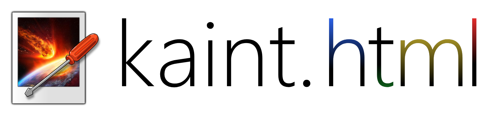

<div align="center">
  

  <h3>Kaint, ported to the web</h3>
  <p>The Paint.NET-style image editor, running entirely in your browser.</p>
</div>

---

**KaintHTML** is the web version of [Kaint](../README.md): the same look, tools, floating
windows, menus, adjustments and effects, written in plain JavaScript with no dependencies and no
build step. Everything runs locally in the browser: images never leave your computer.

## Run it

KaintHTML is a static site. Serve this folder with any web server (ES modules don't load from
`file://`) and open it in a browser:

```bash
cd KaintHTML
python3 -m http.server 8000      # then open http://localhost:8000
```

It can also be published as-is on any static hosting (GitHub Pages, Netlify, your own server).
Chromium-based browsers get the most out of it: saving straight back to the opened file and
reading the clipboard from the menus use their File System Access and Clipboard APIs. Firefox and
Safari download the saved file and paste with Ctrl+V instead.

## What's in it

- **The Kaint interface**: menus, the main toolbar and the tool options bar, Kaint's drawn tool
  icons (also as cursors, with the hot spot on their tip, or small beside the system pointer for
  the selection tools, gradient, line, text and shapes), brush outlines drawn as part of the
  cursor so they follow the mouse without delay, image tabs with thumbnails and the orange star
  of unsaved images, the Tools, History, Layers and Colors windows (dockable to a corner,
  translucent, in a Windows 10 inspired style or compact, with the border width you choose;
  resizing Tools keeps whole columns and Colors scales, like in Kaint), rulers and the status bar
  with the tool icon and the zoom controls. The view scrolls past the edges of the image,
  Ctrl+wheel zooms toward the pointer and the wheel keeps a selection or stroke following the
  pointer while you drag, like in Kaint.
- **All 19 tools**: rectangle, ellipse and lasso select, magic wand, move selected pixels and move
  selection (move, resize, rotate), zoom (with the pixel-snapped rectangle), pan, paint bucket,
  gradient, paintbrush, eraser, pencil, color picker, clone stamp, recolor, text, line/curve and
  the 29 shapes. Selections combine like in Paint.NET (Ctrl, Alt, right click), and the magic wand
  follows the tolerance until you press Enter. Like in Kaint, shapes, lines, text, gradients and
  paint bucket fills stay editable: every change is a history step, and going back to one of them
  lets you keep editing it. A click with Move Selected Pixels selects the whole layer.
- **Toolbar options** like Kaint's: fill patterns, selection quality, tolerance alpha mode, fill
  accumulation, rounded rectangle radius, spiral gradients, the Overwrite blend mode and the
  sampling and gamma of Move Selected Pixels; the paint bucket, gradient and recolor tools use
  Kaint's algorithms. The Shapes menu has Kaint's sections and **custom shapes** (Paint.NET `.xaml`
  files, added in Settings > Shapes and saved in the browser).
- **Layers** with the 14 Paint.NET blend modes, opacity, visibility, drag to reorder (the layer
  follows the mouse, or a line marks where it will go) and their properties dialog; full
  **history** you can click through.
- **All of Kaint's adjustments and effects** (55, Layers > Rotate / Zoom included) with the same
  options and algorithms (ported from Kaint's C++), and dialogs like Kaint's: sliders with reset
  buttons and color strips, angle chooser, center picker over a thumbnail, rotation ball, color
  picker with transparency, tabs, linked values, Curves (luminosity or RGB) and Levels (input and
  output histograms, Auto), and Ctrl+Z / Ctrl+Y for the dialog's changes. The live preview is
  computed in the background, split among several Web Workers (like Kaint's threads), so the page
  never freezes and every change cancels the previous preview; **Ctrl+F** repeats the last one.
- **Image size dialogs** like Kaint's: by percentage or absolute size, keep aspect ratio,
  resolution (pixels/inch or pixels/cm) and print size, memory per layer; Resize with Kaint's eight
  resampling methods and gamma correction; Canvas Size with the anchor arrows. The resolution is
  saved in PNG and JPEG files.
- **Edit** > Copy Selection and Paste Selection (the Paint.NET JSON shape, with the five combine
  modes) and Grow, Shrink and Feather Selection; **View** > Pixels, Inches and Centimeters for the
  rulers and the status bar.
- **Files** like Kaint's: opens PNG, JPEG, WebP, GIF (animated GIFs as one layer per frame), BMP,
  AVIF, ICO, TGA, TIFF and DDS images, **OpenRaster (.ora)** and **Paint.NET (.pdn)** with their
  layers; saves OpenRaster, PNG, JPEG, WebP, DDS, TIFF, GIF (animated, with Kaint's advanced
  options), BMP, TGA and ICO. **Save Configuration** shows the encoded file and its size, with the
  quality, bit depth, dithering and transparency threshold. **Image > Animation** edits the frame
  durations and **Image > Color Profile** converts or assigns sRGB, Adobe RGB, Display P3 or
  ProPhoto RGB (the profile is read from and embedded in PNG, JPEG, WebP and TIFF files). Drop
  images onto the window to open them.
- **Themes**: light and dark (or follow the system), Windows 98 and a custom theme with Kaint's
  editable colors, and the **interface style** of Kaint or the Paint.NET 5 recreation (more
  compact, borderless windows); **English and Spanish** (Kaint's own translations) and Kaint's
  **animations**. The first visit shows a welcome window with the theme, style and language, and
  About looks like Kaint's, with its animated logo.
- **Settings** like Kaint's: interface (reopen the last session's files, recovery copies), canvas
  (custom background, checkerboard brightness, rulers), tools (the default toolbar options every
  session starts with), pen and tablet, performance (history memory limit), plugins, updates,
  diagnostics, icon packs (.zip files with an `asset-pack.json`, with a preview), fonts for the
  Text tool, custom shapes and editable keyboard shortcuts.
- **Recovery copies**: every few minutes, images with unsaved changes are copied into the browser
  (IndexedDB); if the page closes abruptly, Kaint offers them the next time it opens.
- **Colors window** like Kaint's: gap-free swatches and a palette menu with saved palettes, a
  palette file to open or save, Rainbow and Small; **More** widens it with the RGB, HSV and
  opacity sliders, their number boxes and the hex code.

Not available on the web: Paint.NET (.dll) and native plugins and scanning. Reopening the last session's files needs a browser with access to the system's
files (Chrome, Edge...). Browsers keep some shortcuts for themselves (Ctrl+N, Ctrl+W, Ctrl+T): use
the menus for those.

## Development

- `node tools/sync.mjs` copies Kaint's English translations (`../translations/kaint_en.ts`) and
  version (`../version.json`) into `js/i18n/en.js` and `js/version.js`. The interface texts are
  Kaint's Spanish source strings, so the web reuses its translations.
- `node tools/check-i18n.mjs` lists texts that have no English translation yet.
- `node tests/smoke.mjs` drives the editor in a headless Chromium (needs
  `npm install playwright && npx playwright install chromium`) and checks the tools, menus,
  dialogs, layers and saving.

## License

Kaint is free software under the [GNU General Public License v3.0](LICENSE).
`src/pdnbridge/` contains MIT-licensed code from Paint.NET 3.36, `data/icons/` bundles KDE's
Breeze icons (LGPL-3.0-or-later), and the interface

## Disclaimer

Kaint is an independent project. It is not affiliated with, endorsed by or sponsored by dotPDN
LLC or Rick Brewster. Paint.NET is a trademark of dotPDN LLC, mentioned only to describe the
software Kaint is inspired by.