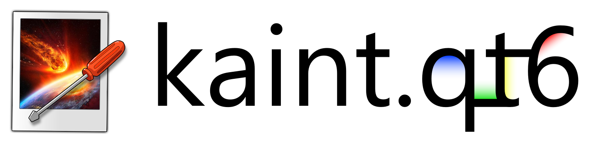
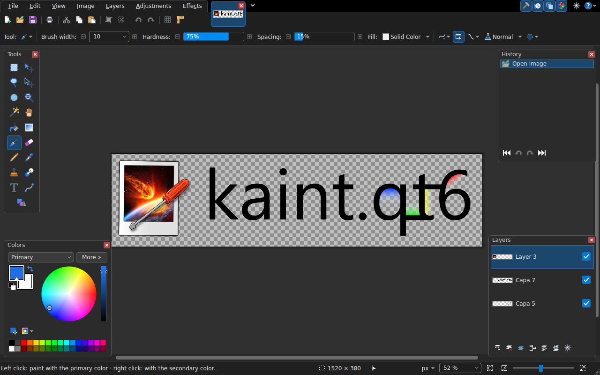
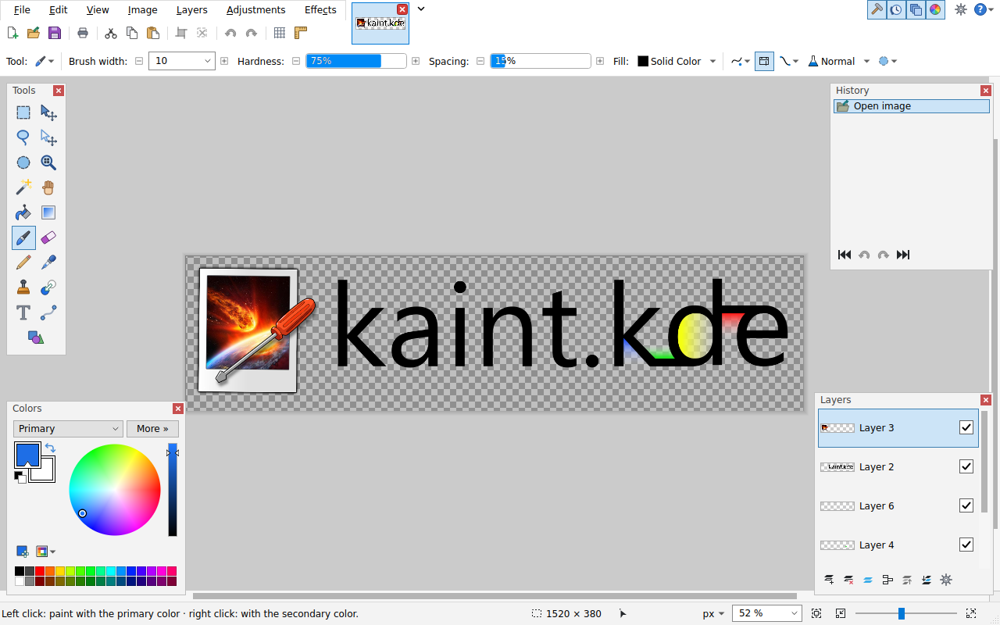

<div align="center">
  

  <h3>The Paint.NET experience, native on Linux (and Windows!)</h3>
  <p>A free raster image editor built with C++20 and Qt 6.</p>

  [](CMakeLists.txt)
  [](https://www.qt.io/)
  [](#-install)
  [](#-features)
  [](LICENSE)

  [](https://ko-fi.com/E1E5ZOEH6)

</div>

<div align="center">
  
</div>

---

**Kaint** recreates the look, the tools and the workflow of [Paint.NET](https://www.getpaint.net/)
as a native application. It is made for KDE Plasma on Wayland, it also
runs on Windows 10 and 11.

## Features

<table>
  <tr>
    <td width="50%" valign="top">
      <h4>Paint.NET tools</h4>
      Selections with their combine modes, move pixels or the selection (scale, rotate, movable
      pivot), brush, pencil, eraser, clone stamp, recolor, paint bucket, gradients, lines and
      curves, shapes and text, all with the same options bar. Pasted pixels replace what is
      underneath, transparency included, like in Paint.NET (optional), and copied images keep
      their transparency in other apps such as Discord or a web browser.
    </td>
    <td width="50%" valign="top">
      <h4>Editable history</h4>
      Click through the history like in Paint.NET. Gradients, lines, shapes, text and paint bucket
      fills stay editable when you go back to one of their steps.
    </td>
  </tr>
  <tr>
    <td valign="top">
      <h4>Layers</h4>
      Blend modes, opacity, visibility and properties, with live thumbnails.
    </td>
    <td valign="top">
      <h4>Adjustments and effects</h4>
      Live preview while you tweak them, and <b>Repeat</b> (Ctrl+F) for the last one.
    </td>
  </tr>
  <tr>
    <td valign="top">
      <h4>Plugins</h4>
      Paint.NET effect plugins (.dll), through mono on Linux and the .NET Framework built into
      Windows, plus native plugins with a stable C API.
    </td>
    <td valign="top">
      <h4>Formats</h4>
      OpenRaster (.ora, with layers), PNG, JPEG, WebP, AVIF, JPEG XL, BMP, TIFF, TGA, animated GIF
      and ICO. Opens Paint.NET <b>.pdn</b> files. Animated GIFs have a playable preview and
      ezgif-style advanced settings: per-frame duration, show/hide and copy, hidden layers as
      frames, global palette, crossfades and a background frame.
    </td>
  </tr>
  <tr>
    <td valign="top">
      <h4>Icon packs, fonts and shortcuts</h4>
      Install <a href="https://github.com/LabyStudio/paintdotjs">paint.js</a> icon packs (.zip),
      add fonts for the Text tool and Paint.NET shapes (.xaml) without installing them system-wide,
      and change any keyboard shortcut in <b>Settings</b>.
    </td>
    <td valign="top">
      <h4>Rulers and status bar</h4>
      Dark rulers like paint.js's (or the toolbar color), with the floating windows kept clear of
      them, and the current tool's icon next to its help in the status bar.
    </td>
  </tr>
  <tr>
    <td valign="top">
      <h4>Recovery copies</h4>
      Unsaved images are kept safe in case Kaint closes unexpectedly.
    </td>
    <td valign="top">
      <h4>Languages</h4>
      English and Spanish (for now).
    </td>
  </tr>
</table>

## Themes

Light and dark (or follow the system), the real KDE theme on Linux, and your own **custom theme**:
colors, toolbar layout and a canvas background image with placement, scale, blur and tint. The
floating windows look like paint.js's Windows 10 windows (or Kaint's compact ones), with the border
width you choose in **Settings → User interface**.

Menus and windows fade in, layers slide into place when you reorder them, the active color slot
and the close buttons of the image tabs animate, and a modal dialog blinks when you click the
window behind it (on X11 and Windows). Turn it all off with **Settings → User interface →
Animations**.

<table>
  <tr>
    <td width="50%"></td>
    <td width="50%"></td>
  </tr>
  <tr>
    <td align="center"><sub>Light</sub></td>
    <td align="center"><sub>Dark</sub></td>
  </tr>
</table>

## 🌐 Web version

[**KaintHTML**](KaintHTML/README.md) is Kaint ported to the web: the same interface, tools,
windows, adjustments and effects in plain JavaScript, running entirely in the browser. Serve the
`KaintHTML` folder with any static web server (`python3 -m http.server`) and open it.

## 📦 Install

Kaint needs **Qt 6.5 or newer**: Arch Linux, Debian 13, Ubuntu 25.04 or newer, or Windows 10/11.
The Flatpak and the AppImage run on other distributions too.

<details open>
<summary><b>📦 Flatpak (any distribution)</b></summary>

Build and install the Flatpak from the source code (needs `flatpak-builder`):

```bash
./build.sh --flatpak        # builds and installs io.github.ssserch.Kaint for your user
flatpak run io.github.ssserch.Kaint
```

Paint.NET plugins work out of the box, because the Flatpak includes mono. Plugins that bring their
own settings window (made with WinForms) need X11, which the Flatpak only gets on Wayland if you
allow it:

```bash
flatpak override --user --socket=x11 io.github.ssserch.Kaint
```

</details>

<details open>
<summary><b>📦 AppImage (any distribution)</b></summary>

```bash
./build.sh --appimage       # builds build-appimage/Kaint-<version>-x86_64.AppImage
chmod +x build-appimage/Kaint-*.AppImage && ./build-appimage/Kaint-*.AppImage
```

The AppImage bundles Qt, so it runs on distributions whose glibc is at least as new as the one it
was built on: build it on the oldest distribution you want to support. Paint.NET plugins use the
system's mono if it's installed, and the KDE theme option needs the native build or the Flatpak.

</details>

<details open>
<summary><b>🐧 Arch Linux</b></summary>

```bash
sudo pacman -S --needed gcc cmake ninja qt6-base qt6-tools qt6-wayland qt6-svg zlib breeze-icons
./build.sh --install        # installs to ~/.local (shows up in the app menu)
```

Or build a native package with `makepkg` and install it with pacman:

```bash
./build.sh --pkg            # builds build-pkg/kaint-<version>-1-x86_64.pkg.tar.zst
sudo pacman -U build-pkg/kaint-*.pkg.tar.zst
```

</details>

<details open>
<summary><b>🍥 Debian / Ubuntu</b></summary>

```bash
sudo apt install build-essential cmake ninja-build qt6-base-dev qt6-base-dev-tools qt6-tools-dev \
    qt6-tools-dev-tools qt6-l10n-tools qt6-svg-plugins qt6-wayland zlib1g-dev libgl-dev breeze-icon-theme file
./build.sh --deb            # builds build-deb/kaint_<version>_amd64.deb
sudo apt install ./build-deb/kaint_*_amd64.deb
```

</details>

<details open>
<summary><b>🪟 Windows 10 / 11</b></summary>

Download the source code and double-click `build.bat` (or run `build.bat --install`). It builds
Kaint and installs it in `%LOCALAPPDATA%\Programs\Kaint` with a Start menu entry; uninstall it
from *Installed apps*. If Qt, MinGW, CMake and Ninja are missing, it offers to download them
(about 1.5 GB) into `%LOCALAPPDATA%\Kaint\toolchain`.

`build.bat --setup` makes `Kaint-<version>-windows-x64-setup.exe`, a regular installer for
sharing: it installs Kaint for the current user (no administrator rights), adds it to the Start
menu (and optionally the desktop) and registers it in *Installed apps*, so it can be removed like
any other application. Its uninstaller can also delete your settings, palettes, plugins, icon packs,
fonts and recovery copies. If NSIS is missing, it offers to download it (about 2 MB).

`build.bat --zip` makes a portable `Kaint-<version>-windows-x64.zip`: unzip it anywhere and run
`Kaint\bin\kaint.exe`.

</details>

> [!TIP]
> Optional extras for more formats and for Paint.NET plugins: `qt6-imageformats kimageformats
> mono libgdiplus` (Arch) or `qt6-image-formats-plugins kimageformat6-plugins mono-devel libgdiplus`
> (Debian/Ubuntu). On Windows, plugins work out of the box.

| Option | `build.sh` (Linux) | `build.bat` (Windows) |
| --- | :---: | :---: |
| Build and install | `--install` | `--install` |
| Build and run | `--run` | `--run` |
| Run the tests | `--test` | `--test` |
| Debug build | `--debug` | `--debug` |
| Package | `--deb` (Debian/Ubuntu) · `--pkg` (Arch) · `--flatpak` · `--appimage` | `--setup` (installer) · `--zip` |
| Every option | `--help` | `--help` |

Packagers can build with `-DKAINT_UPDATE_CHECK=OFF` so that Kaint leaves updates to the package
manager and never looks for new versions on GitHub (the Flatpak does this).

## License

Kaint is free software under the [GNU General Public License v3.0](LICENSE).
`src/pdnbridge/` contains MIT-licensed code from Paint.NET 3.36, `data/icons/` bundles KDE's
Breeze icons (LGPL-3.0-or-later), and the interface icons in `data/ui-icons/` come from SSSerch's
fork of [paint.js](https://github.com/LabyStudio/paintdotjs), used with permission.

## Disclaimer

Kaint is an independent project. It is not affiliated with, endorsed by or sponsored by dotPDN
LLC or Rick Brewster. Paint.NET is a trademark of dotPDN LLC, mentioned only to describe the
software Kaint is inspired by.
