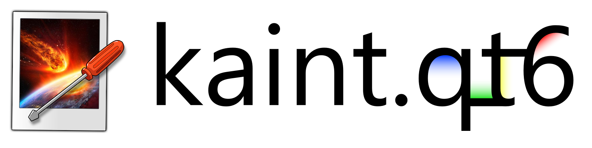
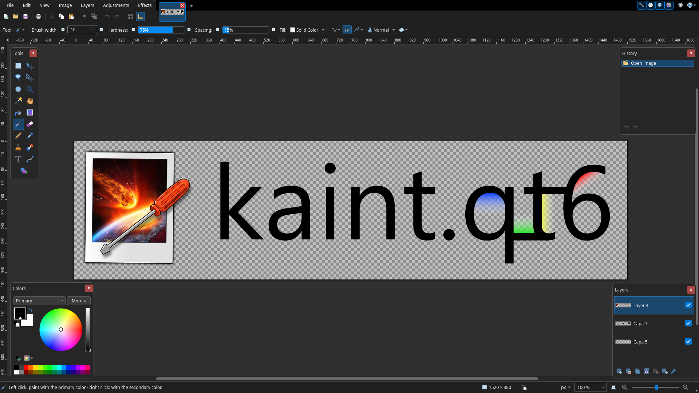
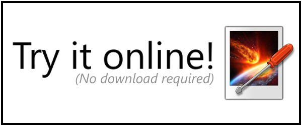
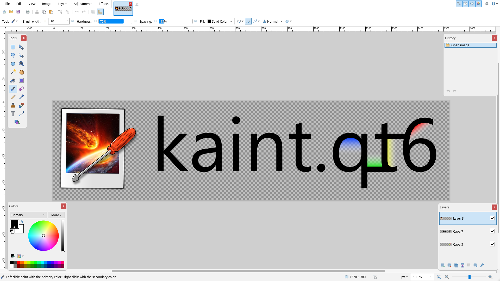
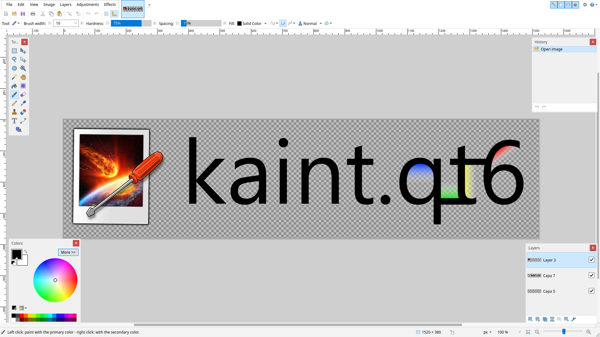
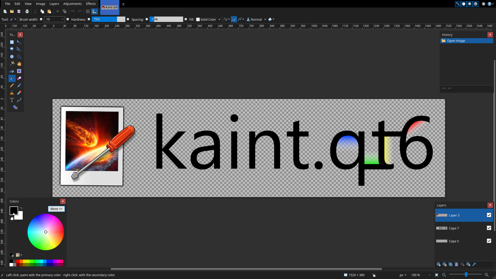

<div align="center">
  

  <h3>The Paint.NET experience, native on Linux (and Windows!)</h3>
  <p>A free raster image editor built with C++20 and Qt 6.</p>

  [](CMakeLists.txt)
  [](https://www.qt.io/)
  [](#-install)
  [](#-features)
  [](LICENSE)

  [](https://ko-fi.com/E1E5ZOEH6)

</div>

<div align="center">
  
  <a href="https://ssserch.github.io/kainthtml/"></a>
</div>

---

**Kaint** recreates the look, the tools and the workflow of [Paint.NET](https://www.getpaint.net/)
as a native application. It is made for KDE Plasma on Wayland, it also
runs on Windows 10 and 11.

## Features

<table>
  <tr>
    <td width="50%" valign="top">
      <h4>Paint.NET tools</h4>
      Selections with their combine modes, move pixels or the selection (scale, rotate, movable
      pivot), brush, pencil, eraser, clone stamp, recolor, paint bucket, gradients, lines and
      curves, shapes and text, all with the same options bar. Pasted pixels replace what is
      underneath, transparency included, like in Paint.NET (optional), and copied images keep
      their transparency in other apps such as Discord or a web browser.
    </td>
    <td width="50%" valign="top">
      <h4>Editable history</h4>
      Click through the history like in Paint.NET. Gradients, lines, shapes, text and paint bucket
      fills stay editable when you go back to one of their steps.
    </td>
  </tr>
  <tr>
    <td valign="top">
      <h4>Layers</h4>
      Blend modes, opacity, visibility and properties, with live thumbnails.
    </td>
    <td valign="top">
      <h4>Adjustments and effects</h4>
      Live preview while you tweak them, and <b>Repeat</b> (Ctrl+F) for the last one.
    </td>
  </tr>
  <tr>
    <td valign="top">
      <h4>Plugins</h4>
      Paint.NET effect plugins (.dll), through mono on Linux and the .NET Framework built into
      Windows, plus native plugins with a stable C API. Also PhotoCraft filter plugins (.wasm, run
      sandboxed in Kaint's own WebAssembly interpreter) and LightCraft looks (.cube, .3dl) and
      develop presets (.xmp), under <b>Effects → Plugins</b>; drop them on the window to install
      them. <b>paint.js plugins</b> (.paintjs) too, the same ones as the web version, with their
      effects and file types (Photoshop PSD with layers, for example), installed from a file or from
      the web version's plugin catalog (<b>Settings → Plugins → Kaint.HTML plugins…</b>, a button you
      turn on in <b>Settings → User interface</b>). They run in a sandboxed JavaScript engine (QuickJS-ng) with no access to
      your files or the internet; plugins that open their own HTML window only work in the web
      version, and Kaint says so. Each effect of a plugin
      can be turned on or off on its own, and native plugins can bring their own menu icon. In the
      menus, plugin effects carry the green puzzle piece on the right (it can be turned off in
      <b>Settings → Plugins</b>).
    </td>
    <td valign="top">
      <h4>Formats</h4>
      Paint.NET <b>.pdn</b> and OpenRaster (.ora), both with layers, PNG, JPEG, WebP, AVIF, JPEG XL,
      HEIC, JPEG XR, BMP, TIFF, TGA, DDS, QOI, Netpbm (PPM, PGM, PBM), animated GIF and ICO. TGA, DDS
      and QOI are read and written by Kaint itself, so they work everywhere; AVIF, JPEG XL, HEIC and
      JPEG XR show up when Qt's image plugins can write them (kimageformats). Animated GIFs open as layers or as separate images, and
      can be saved from the layers or from the open images you pick, with a playable preview and
      ezgif-style advanced settings: per-frame duration, show/hide and copy, hidden layers as
      frames, global palette, crossfades and a background frame.
    </td>
  </tr>
  <tr>
    <td valign="top">
      <h4>Icon packs, fonts and shortcuts</h4>
      Install icon packs (.zip files with an <code>asset-pack.json</code>), each with a preview, or
      make your own with the icon pack <b>Editor</b> (every icon side by side with Kaint's; save it
      or export it as a .zip), add fonts for the Text tool and Paint.NET shapes (.xaml) without installing them system-wide,
      and change any keyboard shortcut in <b>Settings</b>.
    </td>
    <td valign="top">
      <h4>Cursors, rulers and status bar</h4>
      Painting tools use their icon as the cursor, sized like the system cursor and with the hot
      spot on its tip; the selection tools, gradient, line, text and shapes keep the system pointer
      (from your cursor theme, at its size and animated if it is) with a small icon beside it (the
      chosen shape, for Shapes), like Paint.NET. To rotate, the move tools and Shapes show the hand in front of a curved double arrow that turns with it. Dark rulers (or the
      toolbar color) that the floating windows never cover, and the tool's icon in the status bar.
      Open and Save As use the system file dialog, the same one as Firefox (or Qt's, in
      <b>Settings</b>).
    </td>
  </tr>
  <tr>
    <td colspan="2" valign="top">
      <h4>Collaborative mode</h4>
      Host the current image and edit it together with other copies of Kaint or with browsers
      running the web version (<b>File → Collaboration</b>): over the Internet with P2P (the
      default: share the session code and the image goes straight from one computer to the other,
      with WebRTC) or on your local network. Between copies
      of Kaint changes appear in real time; guests can also (and between Kaint and the web, always)
      edit a private draft with its own history and suggest it, and the host accepts it (or accepts
      everything automatically): the change then shows up for everyone and in the host's history
      as "Change made by…". Layer properties are shared too, everyone's pointer is shown as a
      colored triangle with their name and tool, and only the host saves the image (guests export a
      copy). The session image's tab turns yellow and shows whether the host's image is saved (the
      crown) and whether a guest's exported copy is up to date (the computer); from the History
      window everyone can see the host's history, and the host (and the guests it allows) can go
      back to an earlier version for everyone. Sessions can be open, approved one by one, password protected or limited to the
      computers whose ID the host added; on the local network nearby sessions are found
      automatically and you can also join by IP (addresses and codes stay blurred until you click
      them). Everything is in its own <b>Settings → Collaboration</b> section, with a simplified and
      a compact view.
    </td>
  </tr>
  <tr>
    <td valign="top">
      <h4>Recovery copies</h4>
      Unsaved images are kept safe in case Kaint closes unexpectedly.
    </td>
    <td valign="top">
      <h4>Languages</h4>
      English and Spanish (for now).
    </td>
  </tr>
</table>

## Make it yours

Kaint looks the way you want. Almost everything about its appearance can be changed from
**Settings → User interface**, and every change shows at once:

- **Themes**: light and dark (or follow the system), Paint.NET's Blue, **Windows 7** (with 7.css's
  colors and glass buttons), **Windows XP** (Luna, with XP.css's), the classic gray of **Windows 98**
  and **Windows 98 ALT** (the classic look of Windows 2000 and XP),
  the real **KDE** theme on Linux, and a **custom theme** editor with every color,
  the toolbar layout and a canvas background image (placement, scale, blur and tint), which you can
  export and share.
- **Interface style**: Kaint's own or a recreation of **Paint.NET 5** (the default): more compact,
  with borderless windows, tighter menus and buttons, gray and blue bar sliders, hollow ring handles,
  a grid of shapes and Paint.NET's Colors window.
- **Title bar**: Kaint can draw a title bar and window frame of its own (**Settings → User
  interface → Title bar**; on by default on Linux, off on Windows), with the shadow from KWin or
  from Windows; drag it from anywhere. Its buttons can look like those of **Windows 11, 10, 7, XP or
  98, or macOS**, on the right or on the left. Turned off, windows get the system's title bar
  (Windows', or your desktop's: Plasma's on KDE). With the Paint.NET style, the
  **Windows recreation** picks Windows 10 or Windows 11 (slightly rounded windows when not
  maximized). The top bar and the window headers can take **a color of your own**, like Windows'
  accent color.
- **Cursors**: Kaint's tool icons or Paint.NET's pixel-art cursors (the default), with the system
  pointer or Kaint's own beside the small tool icon.
- **Icons and fonts**: install **icon packs** (.zip files with a preview) or create your own with
  the **Editor**, pick the **interface
  font** and its size, and add fonts for the Text tool without installing them system-wide.
- **Floating windows**: a Windows 10 inspired frame or Kaint's compact one, the border width,
  translucency when the pointer leaves them (only while they cover the image, like Paint.NET, or
  always), and **snapping** to the edges and to each other.
- **Menus and tools**: move any effect, plugin ones too, to Adjustments, Effects or another
  submenu (say, a plugin's blur into **Effects → Blurs**), hide the ones you never use, and choose
  which tools the Tools window shows and in what order (**Settings → Customization**).
- **Canvas**: your own background color around the image (one for light themes and one for dark
  ones), the checkerboard brightness, the drop shadow and dark or toolbar-colored rulers.
- **Little touches**: tool icons in the active colors, Paint.NET's orange star on unsaved images
  (on their thumbnail in the strip and in the open images list),
  animations everywhere (fades, sliding layers, the active color slot) that you can turn off, and a
  welcome window on the first start to pick the theme, style, cursors and language.

#### Kaint style

Kaint's own interface: floating windows with a border and slightly rounded corners, and a Colors
window with a primary/secondary selector and a brightness slider.

<table>
  <tr>
    <td width="50%"></td>
    <td width="50%"></td>
  </tr>
  <tr>
    <td align="center"><sub>Light</sub></td>
    <td align="center"><sub>Dark</sub></td>
  </tr>
</table>

#### Paint.NET 5 style

A recreation of Paint.NET 5: more compact, with borderless windows, tighter menus and buttons and
Paint.NET's Colors window, gray and blue bar sliders and hollow ring handles. On Linux the window
and its dialogs draw a Windows 10 or Windows 11 title bar of their own (black, with a shadow; its
buttons can take another look or be turned off in **Settings**). Pick it in **Settings → User interface → Interface style** (or in the
welcome window).

The floating windows snap to the edges of the workspace and to each other (hold Shift to place
one freely, or turn it off in **Settings**), the interface font can be changed, and on Linux the
top bar and the window headers can take a color of your own, like Windows' accent color on title
bars. Effect dialogs have a **Preview** box to compare with the original image.

<table>
  <tr>
    <td width="50%"></td>
    <td width="50%"></td>
  </tr>
  <tr>
    <td align="center"><sub>Light</sub></td>
    <td align="center"><sub>Dark</sub></td>
  </tr>
</table>

## Web version

[**KaintHTML**](KaintHTML/README.md) is Kaint ported to the web: the same interface, tools,
windows, adjustments and effects in plain JavaScript, running entirely in the browser. Serve the
`KaintHTML` folder with any static web server (`python3 -m http.server`) and open it. Browsers on
the network can also join a collaborative session hosted by Kaint by opening the address its
session window shows, and any browser can host or join a P2P session with just its code.

## 📦 Install

Kaint needs **Qt 6.5 or newer**: Arch Linux, Debian 13, Ubuntu 25.04 or newer, or Windows 10/11.
The Flatpak and the AppImage run on other distributions too.

<details open>
<summary><b>📦 Flatpak (any distribution)</b></summary>

Build and install the Flatpak from the source code (needs `flatpak-builder`):

```bash
./build.sh --flatpak        # builds and installs io.github.ssserch.Kaint for your user
flatpak run io.github.ssserch.Kaint
```

Paint.NET plugins work out of the box, because the Flatpak includes mono. Plugins that bring their
own settings window (made with WinForms) need X11, which the Flatpak only gets on Wayland if you
allow it:

```bash
flatpak override --user --socket=x11 io.github.ssserch.Kaint
```

</details>

<details open>
<summary><b>📦 AppImage (any distribution)</b></summary>

```bash
./build.sh --appimage       # builds build-appimage/Kaint-<version>-x86_64.AppImage
chmod +x build-appimage/Kaint-*.AppImage && ./build-appimage/Kaint-*.AppImage
```

The AppImage bundles Qt, so it runs on distributions whose glibc is at least as new as the one it
was built on: build it on the oldest distribution you want to support. Paint.NET plugins use the
system's mono if it's installed, and the KDE theme option needs the native build or the Flatpak.

</details>

<details open>
<summary><b>🐧 Arch Linux</b></summary>

```bash
sudo pacman -S --needed gcc cmake ninja qt6-base qt6-tools qt6-wayland qt6-svg zlib breeze-icons libdatachannel
./build.sh --install        # installs to ~/.local (shows up in the app menu)
```

Or build a native package with `makepkg` and install it with pacman:

```bash
./build.sh --pkg            # builds build-pkg/kaint-<version>-1-x86_64.pkg.tar.zst
sudo pacman -U build-pkg/kaint-*.pkg.tar.zst
```

</details>

<details open>
<summary><b>🍥 Debian / Ubuntu / Mint</b></summary>

```bash
sudo apt install build-essential cmake ninja-build qt6-base-dev qt6-base-dev-tools qt6-tools-dev \
    qt6-tools-dev-tools qt6-l10n-tools qt6-svg-plugins qt6-wayland zlib1g-dev libgl-dev libssl-dev breeze-icon-theme file
./build.sh --deb            # builds build-deb/kaint_<version>_amd64.deb
sudo apt install ./build-deb/kaint_*_amd64.deb
```

</details>

<details open>
<summary><b>🪟 Windows 10 / 11</b></summary>

Download the source code and double-click `build.bat` (or run `build.bat --install`). It builds
Kaint and installs it in `%LOCALAPPDATA%\Programs\Kaint` with a Start menu entry and its own
uninstaller (`Uninstall.exe`, next to the `bin` folder): uninstall it from *Installed apps* or the
*Control Panel* like any other app (or run `build.bat --uninstall`). Installs made with an older
`build.bat` get the uninstaller when you install again. If Qt, MinGW, CMake and Ninja are missing, it offers to download them
(about 1.5 GB) into `%LOCALAPPDATA%\Kaint\toolchain`.

`build.bat --setup` makes `Kaint-<version>-windows-x64-setup.exe`, a regular installer for
sharing: it installs Kaint for the current user (no administrator rights), adds it to the Start
menu (and optionally the desktop) and registers it in *Installed apps*, so it can be removed like
any other application. Its uninstaller can also delete your settings, palettes, plugins, icon packs,
fonts and recovery copies. If NSIS is missing, it offers to download it (about 2 MB).

`build.bat --zip` makes a portable `Kaint-<version>-windows-x64.zip`: unzip it anywhere and run
`Kaint\bin\kaint.exe`.

</details>

<details open>
<summary><b>🟢 Android (Kaint.APK)</b></summary>

Kaint.APK is the web version (`KaintHTML`) as an Android app (`android/`). `./build-apk.sh` asks
whether you want an **APK** (to install on the phone) or an **App Bundle** (to publish on Google
Play), where `KaintHTML` is (Enter accepts this repository's) and, for the App Bundle, your upload
key, its alias and passwords. The result goes to `build-apk/Kaint-<version>.apk` or
`build-aab/Kaint-<version>.aab`. It needs a JDK from 17 to 25 (21 is best: `jdk21-openjdk` on Arch,
`openjdk-21-jdk` on Debian/Ubuntu); the Android SDK command-line tools and Gradle are downloaded the
first time if missing (checked against their checksums), and you accept the Android SDK licenses
yourself. APKs are signed with a key kept on this computer, so newer versions install over older
ones.

```bash
./build-apk.sh              # asks APK or App Bundle, the KaintHTML folder and (AAB) your key
adb install -r build-apk/Kaint-*.apk
```

</details>

> [!TIP]
> Optional extras for more formats and for Paint.NET plugins: `qt6-imageformats kimageformats
> mono libgdiplus` (Arch) or `qt6-image-formats-plugins kimageformat6-plugins mono-devel libgdiplus`
> (Debian/Ubuntu). On Windows, plugins work out of the box.

| Option | `build.sh` (Linux) | `build.bat` (Windows) |
| --- | :---: | :---: |
| Build and install | `--install` | `--install` |
| Build and run | `--run` | `--run` |
| Run the tests | `--test` | `--test` |
| Debug build | `--debug` | `--debug` |
| Package | `--deb` (Debian/Ubuntu) · `--pkg` (Arch) · `--flatpak` · `--appimage` | `--setup` (installer) · `--zip` |
| Every option | `--help` | `--help` |

Packagers can build with `-DKAINT_UPDATE_CHECK=OFF` so that Kaint leaves updates to the package
manager and never looks for new versions on GitHub (the Flatpak does this).

## License

Kaint is free software under the [GNU General Public License v3.0](LICENSE).
`src/pdnbridge/` contains MIT-licensed code from Paint.NET 3.36, `data/icons/` bundles KDE's
Breeze icons (LGPL-3.0-or-later), and the Windows 7, Windows XP and Windows 98 themes and title bar
buttons use colors, gradients and drawings from [7.css](https://khang-nd.github.io/7.css/) by Khang
Nguyen Duy, [XP.css](https://botoxparty.github.io/XP.css/) by Adam Hammad and Jordan Scales and
[98.css](https://jdan.github.io/98.css/) by Jordan Scales (all MIT, see `data/licenses/`).
`third_party/quickjs-ng/` is [QuickJS-ng](https://github.com/quickjs-ng/quickjs) (MIT), the
JavaScript engine that runs paint.js plugins. Kaint supports the plugins of
[paint.js](https://github.com/LabyStudio/paintdotjs) by LabyStudio (.paintjs packages and their
JavaScript API); it doesn't use paint.js's own plugin system. The P2P collaboration uses
[libdatachannel](https://github.com/paullouisageneau/libdatachannel) (MPL-2.0) with usrsctp
(BSD-3-Clause), libjuice (MPL-2.0) and plog (MIT), and Mbed TLS (Apache-2.0) where there is no
OpenSSL.

## Disclaimer

Kaint is an independent project. It is not affiliated with, endorsed by or sponsored by dotPDN
LLC or Rick Brewster. Paint.NET is a trademark of dotPDN LLC, mentioned only to describe the
software Kaint is inspired by.
