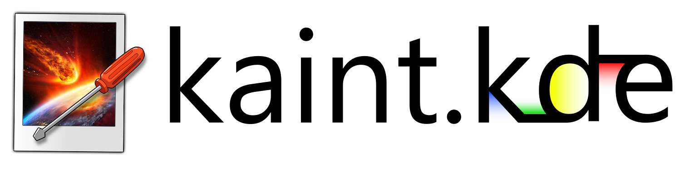

<div align="center">
  
  <p><strong>A recreation of Paint.NET for Linux, built with C++20 and Qt 6.</strong></p>

  [](CMakeLists.txt)
  [](https://www.qt.io/)
  [](#install)
</div>

<div align="center">
  
</div>

---

**Kaint** is a free raster image editor that recreates the look, the tools and the workflow of
[Paint.NET](https://www.getpaint.net/) on Linux. It is native (no Wine, no .NET runtime), made
for KDE Plasma on Wayland, and it should feel like home if you come from Paint.NET.

## Features

- **Layers** with blend modes, opacity and a history you can click through.
- **The Paint.NET tools**: selections with their combine modes, move pixels or selection (scale,
  rotate, movable pivot), brush, pencil, eraser, clone stamp, recolor, paint bucket, editable
  gradients, lines and curves, shapes, text and more, with the same options bar.
- **Adjustments and effects** with live preview, plus **Repeat** (Ctrl+F).
- **Paint.NET plugins** (.dll, through mono) and native plugins with a stable C API.
- **Formats**: OpenRaster (.ora, with layers), PNG, JPEG, WebP, AVIF, JPEG XL, BMP, TIFF, TGA,
  animated GIF and ICO. Opens Paint.NET **.pdn** files.
- **Themes**: Paint.NET light and dark, follow the system, the real KDE theme, or your own
  custom theme (colors, canvas background image, toolbar layout).
- **Recovery copies** of unsaved images, in case Kaint closes unexpectedly.
- English and Spanish.

## Install

Kaint needs **Qt 6.5 or newer**: Arch Linux, Debian 13, Ubuntu 25.04 or newer.

**Arch Linux**

```bash
sudo pacman -S --needed gcc cmake ninja qt6-base qt6-tools qt6-wayland qt6-svg zlib breeze-icons
./build.sh --install        # installs to ~/.local (shows up in the app menu)
```

**Debian / Ubuntu**

```bash
sudo apt install build-essential cmake ninja-build qt6-base-dev qt6-base-dev-tools qt6-tools-dev \
    qt6-tools-dev-tools qt6-l10n-tools qt6-svg-plugins qt6-wayland zlib1g-dev libgl-dev breeze-icon-theme
./build.sh --deb            # builds build-deb/kaint_<version>_amd64.deb
sudo apt install ./build-deb/kaint_*_amd64.deb
```

Optional extras for more formats and for Paint.NET plugins: `qt6-imageformats kimageformats mono
libgdiplus` (Arch) or `qt6-image-formats-plugins kimageformat6-plugins mono-devel libgdiplus`
(Debian/Ubuntu). `./build.sh --help` lists every option (`--run`, `--test`, `--debug`...).

## Contributing

Issues and pull requests are welcome: fork the repository, make your change in a branch, check
that `./build.sh --test` passes and open a pull request. Bugs and ideas go to
[Issues](https://github.com/ssserch/Kaint/issues).

## License

See [LICENSE](LICENSE). `src/pdnbridge/` contains MIT-licensed code from Paint.NET 3.36, and the
Paint.NET-style icons are adapted from [paint.software](https://github.com/Univers4craft/paint.software)
(MIT).

## Disclaimer

Kaint is an independent project. It is not affiliated with, endorsed by or sponsored by dotPDN
LLC or Rick Brewster. Paint.NET is a trademark of dotPDN LLC, mentioned only to describe the
software Kaint is inspired by.
